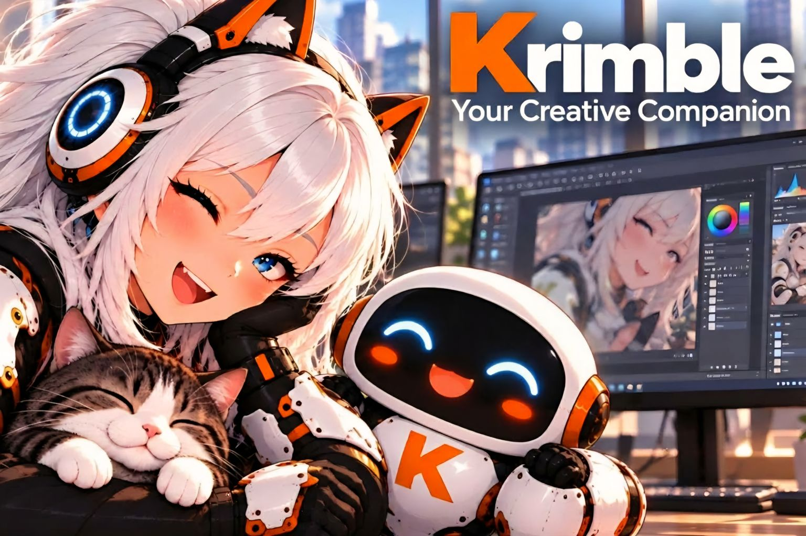
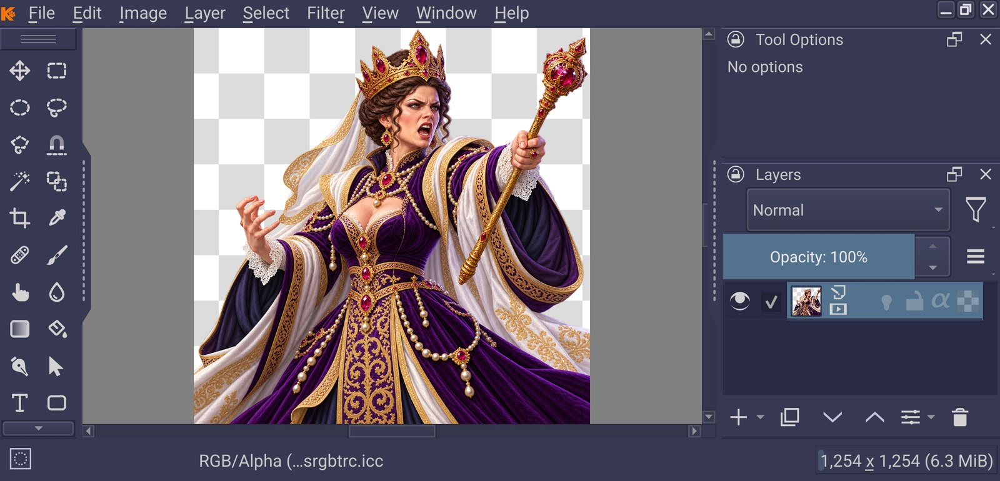
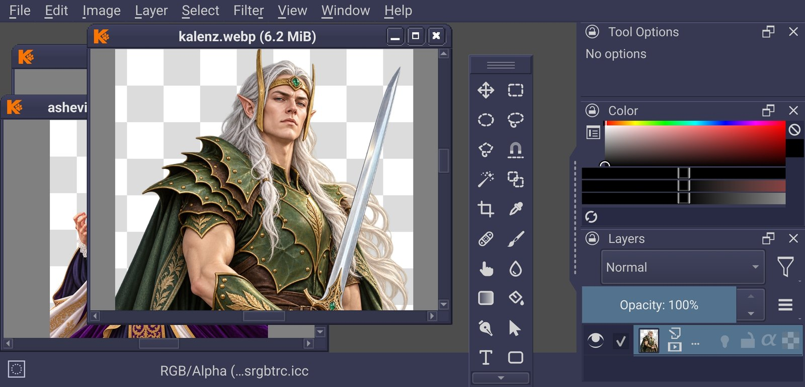
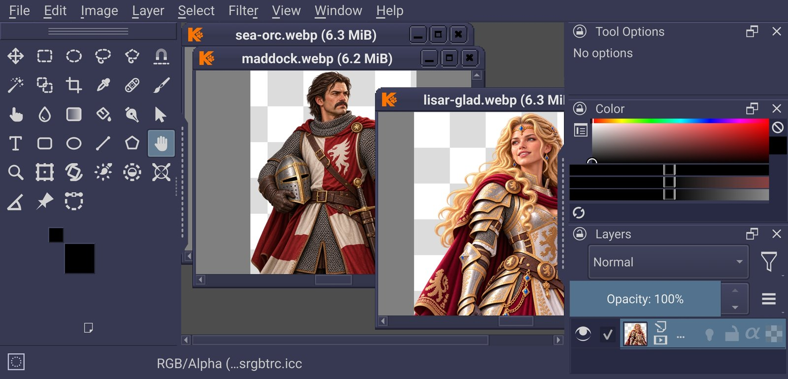
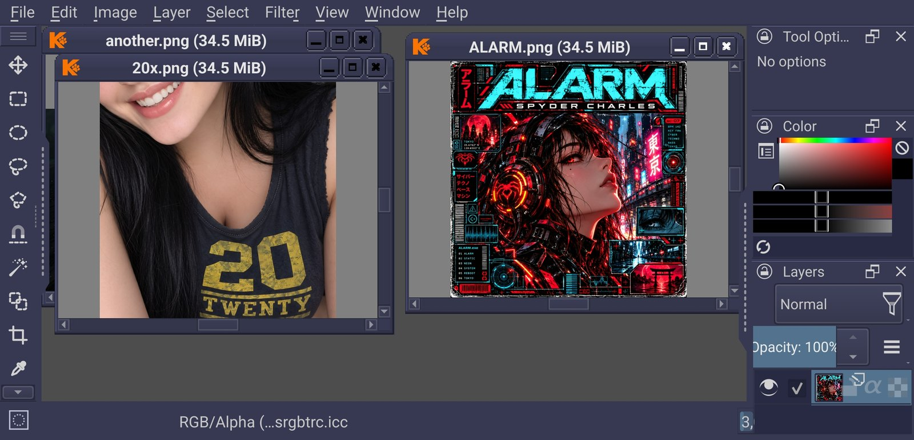
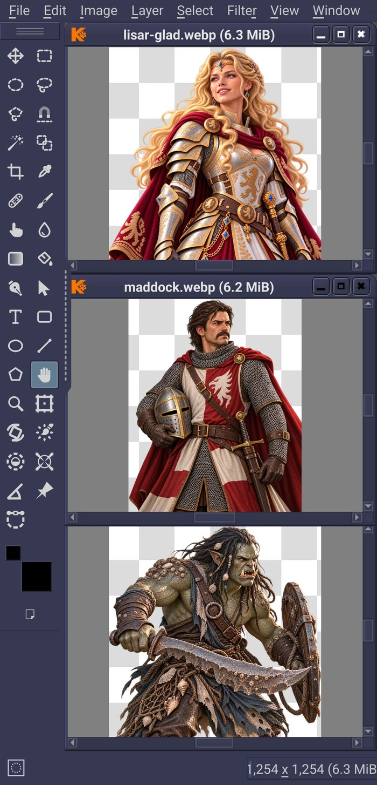
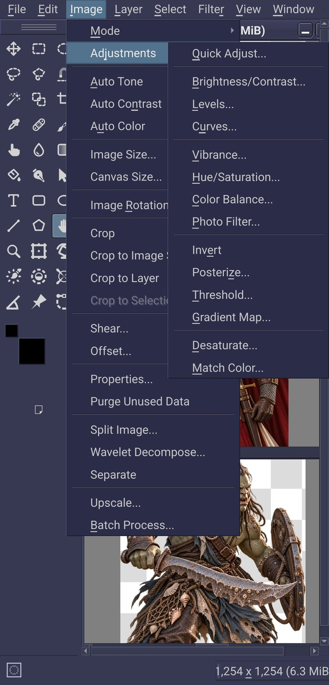

**A graphics editor built for Android phones.**

[Website](https://krimble.org) · [Source](https://github.com/purdygeorgeedward-dev/krimble) · [Roadmap](#development-roadmap) · [Support Krimble](#support-krimble)

---

## What is Krimble?

Krimble is a **mobile-first fork of Krita** designed to be a graphics workhorse for Android phones rather than a paint/animation app squeezed onto a small screen.

The project focuses on the realities of touchscreen input and limited screen space: removing unnecessary interface clutter, resizing and reorganizing controls, changing defaults that make more sense on a phone, improving touchscreen targets, simplifying workflows, and adding graphics-editing tools that are useful for professional creative work.

Krimble is built on the extraordinary foundation of [Krita](https://invent.kde.org/graphics/krita), while taking a different direction for mobile use.

### What is Mobile-First? 📱

Krimble is designed around **phones and touch** on a smaller display.

That means:

- touch-sized controls and resize handles
- menus and dialogs designed for small screen
- mobile-friendly defaults
- simplified tool and panel behavior
- industry-standard terminology
- workflows that do not assume a mouse or keyboard

---

## SEE IT IN ACTION 📸

Krimble works the way people actually work; **several images open at once, each in its own window**, with the toolbox and panels where you expect them, whether held sideways or upright.

*The editor on one phone screen: toolbox, image, Tool Options and Layers.*

*Pull the toolbox off its sticky edge and put it where you want it.*

*Three images open in their own windows, with the full toolbox and the Tool Options, Color and Layers panels.*

*A slimmer toolbox and two images side by side. (Cover art: "20" by Marque English and "Alarm" by Spyder Charles.)*

<table>
<tr>
<td align="center" width="50%"></td>
<td align="center" width="50%"></td>
</tr>
<tr>
<td align="center"><em>Held upright: a two-column toolbox and images stacked.</em></td>
<td align="center"><em>Image &gt; Adjustments: Levels, Curves, Vibrance, Gradient Map, Match Color and more.</em></td>
</tr>
</table>

---

## WHY KRIMBLE? 🤔

I am a lifelong professional artist trained across traditional media and digital tools. Trying to paint with a phone is as appealing to me as writing with a bar of soap. Instead of a paint app, Krimble is a graphics tool for basic tasks. Compare to your favorite desktop graphics applications.

**Same job, but smaller.**

---

## WHAT KRIMBLE CHANGES 🪄

Krimble already includes many changes to make the app more usable and familiar on mobile:

| Area | Krimble direction |
|---|---|
| **Navigation** | Pan/Hand (non-destructive) as the default tool instead of Paintbrush (destructive) |
| **Toolbox** | Reordered around familiar graphics-editing applications, flyouts added |
| **Menus** | Simplified, renamed, and reorganized based on popular applications for familiarity |
| **Panels** | User-facing “docker” terminology replaced with **panel**; **Detach Panel** and **Attach Panel** in the Settings menu float any panel and dock it back; floating panels stay where dropped and have a corner resize handle |
| **Touch** | Larger crop handles, wider resize targets, mobile selection handles |
| **Transform** | Transform defaults to uniform scaling; accidental shear prevented |
| **Color Lab** | User-friendly simple square color selector; multi-panel controls |
| **Editing** | Healing Brush, Content-Aware Fill, QuickAdjust menu |
| **Branding** | Krimble identity, mascot, icon, app labels, splash, links, versioning and support graphics |
| **Automation** | Batch Process recipes (JPG, PNG, WebP with transparency) and **Krimble Script**, a tiny script language for simple operations on many pictures |
| **Shortcuts** | Wide shortcut-alignment pass for familiar keystrokes where practical |

---

## NEW CREATIVE TOOLS 🎨

Krimble is expanding beyond interface adaptation into new graphics-editing capabilities.

Recent and active work includes:

- **Healing Brush** 🩹
- **Content-Aware Fills** 🫗
- **Vibrance color adjustment** 🌈
- **Image Upscaling** 🆙
- **Advanced Color Matching and Separations** 🦚
- improved graphics editing workflows
- replayable Actions with captured parameters
- **Eraser tool** 🧽: a dedicated toolbox tool that paints transparency with the current brush
- **Batch Processing** 🧰 with saved **recipes**: resize, convert to JPG, PNG or **WebP with transparency**, rename, many pictures at once
- **Krimble Help** 📖: a help file inside the app (Help > Krimble Help), with search function
- **Animated GIF and WebP in Batch Processing** 🎞️: read animated GIF and WebP, write animated WebP (smaller than the GIF, with transparency), or save the frames as separate numbered pictures
- **Krimble Script** 📜: a tiny scripting language (15 commands) for simple operations: resize, crop, rotate, flip, gray, brightness, contrast, flatten, format, name, folder, frames, fps, loop. See [KRIMBLE_SCRIPT.md](KRIMBLE_SCRIPT.md)
- **SmartCompression** 🗜️: saves a JPEG smaller where the loss does not show, with a live preview of the original and compressed sizes
- **Custom CMYK** 🖨️: Edit > Custom CMYK... makes an ICC output profile from your own ink and paper settings, for converting a picture to CMYK and soft proofing
- **Channels panel** 🎚️: tap a channel to isolate it, load a channel as a selection
- **Color Lab** 🎨: a color panel with Picker, Sliders, Values, Palette and History tabs, a stretchable color square, and CMYK palettes
- **QuickAdjust** ⚡: Image > Adjustments > QuickAdjust..., one window of sliders for the common corrections, with an option to keep the result as layers
- **New themes** 🌙: Krimble Blue-Gray (the default), Krimble Bevel and Krimble Painted, with raised and recessed edges and a Flat or Raised toolbox button style
- **Hexagon Selection** ⬢ and **Polygon and Star** ⭐ tools, with a hex grid overlay
- **Auto Crop** ✂️ in the Image menu
- **Long press flyouts** in the toolbox: hold a tool to reach the rest of its group (Marquee, Lasso, Wand, Shapes, Fill and more)
- **Lens Flare** ✨: Filter > Render > Lens Flare..., four flare types made from scratch (Zoom lens, Prime lens, Cinematic anamorphic, Starburst), with sliders for where the light is, brightness, rays, ghosts, ring and color, and a live preview. Dragging the light around on the picture with a finger is in development.
- additional restoration and editing tools

Some of these are already implemented; others are still in development.

---

## I ❤️ A. I.! 

Unlike Krita, Krimble does not have a moratorium on artificial intelligence.

AI is way too useful to exclude, and honestly without Claude this project would be impossible. Claude does the heavy lifting with coding, as is rapidly becoming an industry standard, and ChatGPT handles most of the original graphics.

Artificial Intelligence is like a brilliant child. Children make mistakes. That's what Daddy is there for.

---

## DEVELOPMENT ROADMAP 🗺️

Krimble has already completed a massive amount of work. The detailed engineering log is preserved, but documented elsewhere so the README remains readable.

### Current Work 🚧

- Finish the text-selection **magnifier/loupe** for precise cursor placement.
- Extend two-finger movement selectively to additional floating windows where useful.
- Decide how replayable **Actions** should target layers across different documents.
- Complete and test planned **Upscaling**, **Vibrance**, and additional restoration/editing tools.
- Build and validate distribution targets.
- **Animation and game sprites** (proposed): animated GIF and WebP, frame tags, sprite sheets, game-engine export. See the roadmap (`KRIMBLE_ROADMAP.md`).

<strong>Completed and implemented work — 35 major roadmap items</strong>

1. **Default tool changed to Pan/Hand.** Also fixed a separate path that forced Brush whenever a pixel layer was selected. 
2. **Smaller splash image** for mobile screens. 
3. **Selective two-finger movement** implemented for `KisDockerHud`, with touch-event handling designed not to interfere with ordinary single-finger controls.
4. **Tools menu removed** to make Settings easier to reach.
5. **Toolbox default order rebuilt** around a unified familiar graphics-tool sequence; stale factory shortcuts corrected for keyboard users.
6. **Automatic recovery dialog on startup limited** for faster mobile workflow.
7. **Preferences moved under Edit** and renamed appropriately.
8. **Menus reconfigured**, putting items where professionals expect to find them.
9. **Rotation removed from pinch-zoom defaults.** Because it was annoying to use.
10. **Transform made safer for touch**, with shear-by-drag gated behind an explicit option; an uninitialized transform variable was also fixed.
11. **Industry-standard terminology pass**, so tools are called what pros expect.
12. **Snapping defaults to OFF.** No default pushy actions on mobile displays.
13. **200% zoom command added and tested.**
14. **Custom default toolbar created.**
15. **Brightness/Contrast dialog added and tested.**
16. **Touch resizing improved:** crop handles enlarged to mobile-scale targets. Sizing gadgets for panels adjusted.
17. **Text/Type workflow substantially rebuilt:** better menu, larger grab sensitivity, new fonts.
18. **Krimble splash images created.**
19. **Oversized dialogs audited and reduced** for phone screens; JUMBO DIALOGS limited.
20. **Krimble app icon created and implemented** across required variants.
21. **Save-format list trimmed.** Dialog adjusted.
22. **~200 hardcoded shortcuts aligned** where possible and the preferred shortcut scheme made default.
23. **Tool-selection keys reassigned** to familiar keys wherever possible.
24. **User-facing “dockers” terminology replaced with “panels.”**
25. **Version reset to Krimble `1.0.0-alpha1`.**
26. **Full user-facing Krita → Krimble branding pass**, while deliberately preserving internal compatibility identifiers and historical references where changing them would be harmful.
27. **Project links redirected** to Krimble resources, source, support, and placeholders for developing documentation/community pages.
28. **Panels no longer aggressively dock themselves back into docking zones** after being dragged.
29. **Crop defaults to subtractive-only**, preventing unintentional canvas growth.
30. **Default color selector changed** to square saturation/value plus hue strip for touch.
31. **Content-Aware Fill added**, work-in-progress using existing algorithms as reference.
32. **Match Color rebuilt** to use open documents/layers and provide Luminance, Color Intensity, Fade, and Neutralize controls.
33. **Transform always starts in Uniform Scale mode** unless deliberately changed in tool options.
34. **Actions now capture real parameters** for filters, selection modifications, and image operations rather than merely reopening empty dialogs.
35. **Dialogs are prevented from spawning above the toolbar** through a shared `KoDialog::showEvent()` correction.

<strong>Bug fixes and corrections</strong>

1. Fixed Move-tool behavior that could accidentally trigger whole-image movement from a touch long-press path.

2. Fixed the remaining hardcoded Brush activation in `KisView.cpp` so the Pan/Hand default is actually honored.

3. Replaced remaining “Next” launcher/adaptive icon assets that still contained the old Krita mark.

4. Corrected developer-build/version-flag handling; the current alpha status is deliberate under Krimble versioning.

5. Removed the hardcoded “Artwork by: Tyson Tan” splash credit from the Krimble-specific splash.

6. Removed a leftover invented legal-entity reference and replaced it with: **“The Krimble Project is committed to preserving Krimble as free software.”**

7. Removed references to a popular graphics application that had been inserted into the README by an AI tool.

---

## BUILD TARGETS 🎯

Planned Targets:

| Platform | Target |
|---|---|
| Android | arm64-v8a — Play Store |
| Android | arm64-v8a — F-Droid |
| Linux | x86-64 |
| Windows | Desktop |
| iOS | Planned |
| macOS | Planned |

Android is just the beginning.

---

## THANK YOU! 🙏

Krimble exists because of these. They are not connected to Krimble and have not endorsed it; we are simply grateful for their services.

-  **Claude** (Anthropic): helped design and write much of Krimble's code and documentation.
-  **ChatGPT** (OpenAI): ideas, art direction and troubleshooting along the way.
-  **Termux**: the Android terminal that runs the whole build from a phone.
-  **GitHub**: hosts the code, the releases and the issue tracker. What would we do without it?

---

## SUPPORT KRIMBLE! ☕

Krimble is free and open source, but development still takes time and resources.

If Krimble is useful to you, voluntary support helps fund continued development, testing, infrastructure, artwork, and future distribution.

(I am currently indigent and living in a halfway house in El Paso, Texas. All development is being done on a Samsung Galaxy smartphone.)

### [Support Krimble on Buy Me a Coffee ☕](https://www.buymeacoffee.com/GeorgeEdwardPurdy)

You can also help by testing, reporting issues, improving documentation, contributing code, or simply sharing the project with others.

---

## Upstream Krita resources

Krimble is forked from Krita and continues to benefit from upstream Krita development.

- [Krita User Manual](https://docs.krita.org/en/user_manual.html)
- [Krita build instructions](https://docs.krita.org/en/untranslatable_pages/building_krita.html)
- [Krita developer guides and notes](https://docs.krita.org/en/untranslatable_pages.html)
- [Krita APIdox](https://api.kde.org/legacy/krita/html/index.html)
- [Krita Project Website](https://www.krita.org)
- [Upstream source](https://invent.kde.org/graphics/krita)

---

## License

Krimble, like Krita, is open source software. The project as a whole is licensed under the **GNU General Public License, Version 3**. Individual files may use different compatible licenses.

See the repository's [LICENSES](LICENSES) directory for details.

---

### Create. Edit. Enhance. Anywhere!

**Krimble — Your Creative Companion**

[krimble.org](https://krimble.org)

